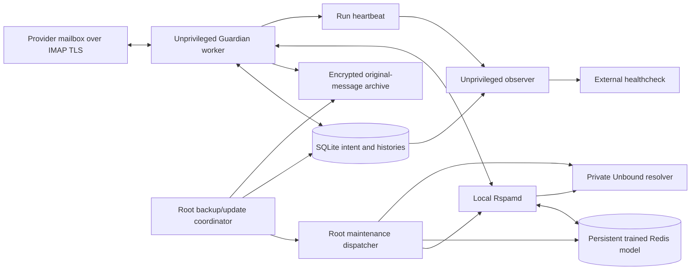

# Architecture and invariants

Guardian is a delivered-mail IMAP client, not an SMTP gateway. It uses Rspamd,
Redis and Unbound locally; it does not send mail content to an LLM. It cannot
rescue messages rejected before delivery or guarantee recovery after a provider's
own retention deletion. Keep uncertain messages in dedicated review folders.

## Find the owning code

| Concern | Owner | Start reading |
| --- | --- | --- |
| CLI/API and runtime assembly | `cmd/guardian` | `main.go`, `api.go`, `server.go` |
| Mail workflow, feedback, decisions, reconciliation | `internal/engine` | `engine.go`, `policy.go`, `mime.go` |
| TLS/IMAP, UID operations, command deadlines | `internal/imapmail` | `client.go`, timeout and integration tests |
| SQLite transactions, intent and histories | `internal/store` | `store.go`, `configuration.go`, `deployment.go` |
| Encrypted message archive | `internal/archive` | `archive.go` |
| Account/provider identity and secrets | `internal/config`, `provider`, `secrets` | identity/profile and credential readers |
| Rspamd scans and learning | `internal/rspamd` | `client.go` |
| Container health, persistence and model checkpoints | `internal/stack` | `stack.go`, `storage_health.go`, `redis_capture.go` |
| Transfer/readiness and isolated snapshots | `internal/migration`, `migrationfixture` | snapshot/config/readiness and roundtrip tests |
| Encrypted recovery format/catalog | `internal/recoverybundle` | bundle, receipt and catalog code |
| Redis content/expiry comparison | `internal/redismodel` | reader and comparison code |
| Operator recovery CLI | `cmd/guardian-recovery` | command dispatch and `operations.go` |
| macOS native UI and process/JSON bridge | `macos/Sources/O2MailGuardianApp` | workflows, API models and app entry |
| Linux provisioning/runtime | `deploy/linux` | installer, maintenance dispatcher, observer and backup |
| Server package/image/application updates | `ops/vps-maintenance` | [maintenance map](../../ops/vps-maintenance/README.md) |

## Data flow and trust boundaries

The worker user (`mg-INSTANCE`) receives specific systemd credentials and a
closed administrative command set. It does not own Docker. The root coordinator
verifies paths, ownership, manifests and locks before mutation. Keep these
boundaries even when simplifying maintenance.

## One message, one durable intent

Before a move, Guardian stores an encrypted copy and a pending database record.
A provider's command response may be lost or incomplete after the server has
already changed mail. Therefore transport error and operation failure are not
equivalent, and repeating the command blindly is unsafe.

| State family | Meaning | Permitted next step |
| --- | --- | --- |
| `kept`, `observed` | Completed non-move assessment | Rescan only under the policy's configured conditions |
| `pending_learn` | Learning intent not fully settled | Reconcile learning/feedback; do not invent success |
| `pending_move` | Move intent saved, destination not finalized | Confirm location and content before retrying |
| `move_ambiguous`, `blocked`, `error` | Insufficient or conflicting evidence | Preserve archive and expose unresolved work |
| `quarantined`, `rescued`, `review` | Confirmed destination recorded | Normal retention/feedback handling |
| `pending_restore` | Restore intent in progress | Reconcile existing copies before appending |
| `restored`, `superseded`, `purged` | Historical terminal outcome | Preserve history; do not replay the old action |

Not every state above is a message `status` accepted by the observer: restore
intents and auxiliary work may be represented in dedicated tables. The schema
and its owning tests are authoritative; update the observer's supported-state
contract when introducing a schema/state change.

`movePending` uses the real client's `MoveWithRaw` capability. Native MOVE is
required; a COPY/STORE/EXPUNGE emulation is not an acceptable substitute. With a
valid COPYUID mapping the location can be finalized directly. Without one,
confirmation checks new destination UIDs, full SHA-256 equality and unchanged
UIDVALIDITY. The 1 November hardening permits three read-only attempts with
250 ms and 750 ms waits and fetches BODY.PEEK[] without ENVELOPE. It never repeats
MOVE during confirmation. Candidate-window overflow, duplicates, UIDVALIDITY
changes and read errors remain unresolved for durable reconciliation.

The reconciliation path can narrow by exact RFC822 size before reading candidate
bodies, avoiding unrelated unreadable messages. Size and Message-ID alone never
identify a message; full bytes must match. Partial scanning progress is durable.
A completed old source operation cannot be retried using a UID from another
mailbox epoch or configuration.

## Filtering, feedback and model safety

New installations remain protective until their own authorization and quality
requirements pass. Elapsed observation time alone is insufficient. Qualification
uses disjoint training/tuning/test partitions; replaying already trained mail
cannot manufacture evidence. Reference thresholds are deployment policy, not a
reason to rewrite defaults or tests to produce a desired count of review mail.

Explicit training-folder corrections are processed before automatic actions.
The latest confirmed correction controls current feedback. Historical ham
feedback continues to veto permanent deletion. A skipped learn is not counted
as a successful statistical learn; an uncertain reply must not cause repeated
learning without reconciliation.

The model, database and archive belong to the same operational generation.
Persistence checks, model capture and checkpoint-required state prevent a
partially saved training update from being advertised as healthy. A restore
must preserve current compatible server state; loading an older model beside a
newer database can silently undo learned protection.

## Identity, locks and health

Configuration/account fingerprints bind persisted UIDs, authorization and
quality evidence to the correct mailbox. Deployment identity binds an adopted
server instance to its host/configuration. Changing connection/folders requires
the prescribed new authorization and dry run; copying a database is not enough.

The local worker lock, Linux migration fence, root maintenance lock and global
update lock protect different actors. Disabling a timer does not stop an active
worker. See [operations](OPERATIONS.md) for lock ordering and pending ownership.

A oneshot service being inactive is normal between checks. Health requires a
matching completed actual run and heartbeat, current identity, no unresolved
operations and no outstanding model checkpoint. A loaded timer, healthy Redis,
or a successful updater discovery cannot establish that mail was processed.

The observer has a bounded freshness horizon; it cannot keep an indefinitely
stopped worker green. It defers briefly during real work rather than inventing
a success. It reports only status, never mail bodies or credential-bearing URLs.
Notification receipt is a separate acceptance check from HTTP delivery.
